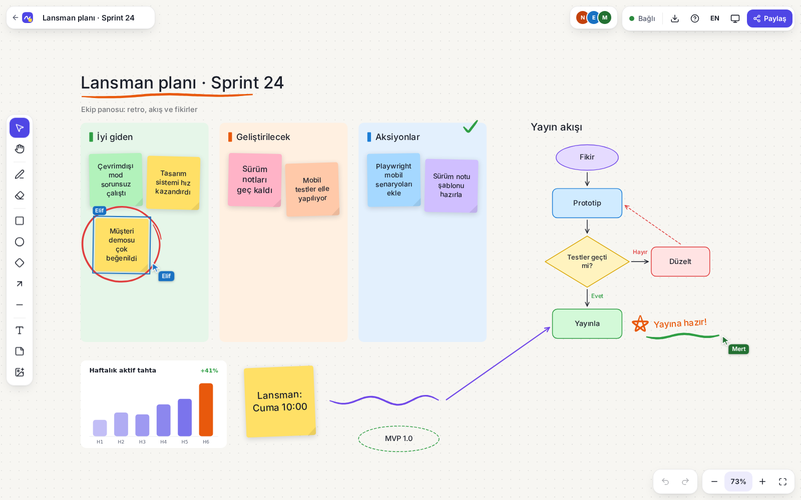
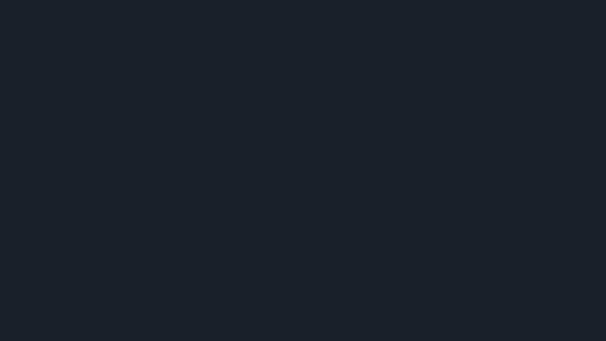
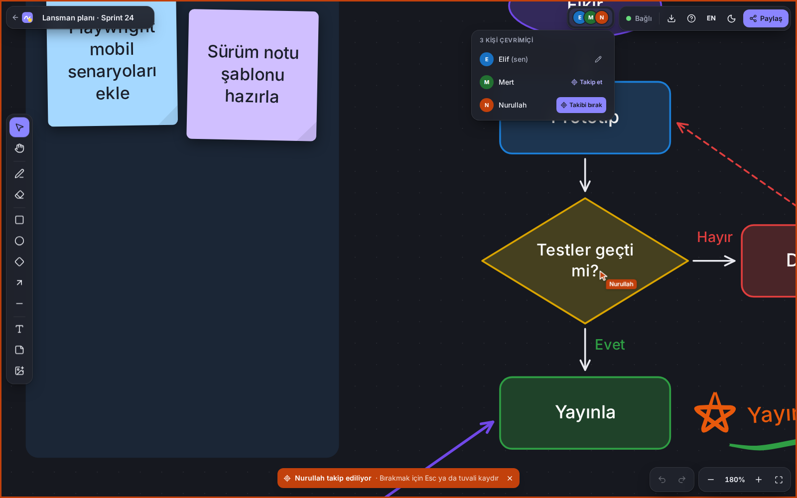
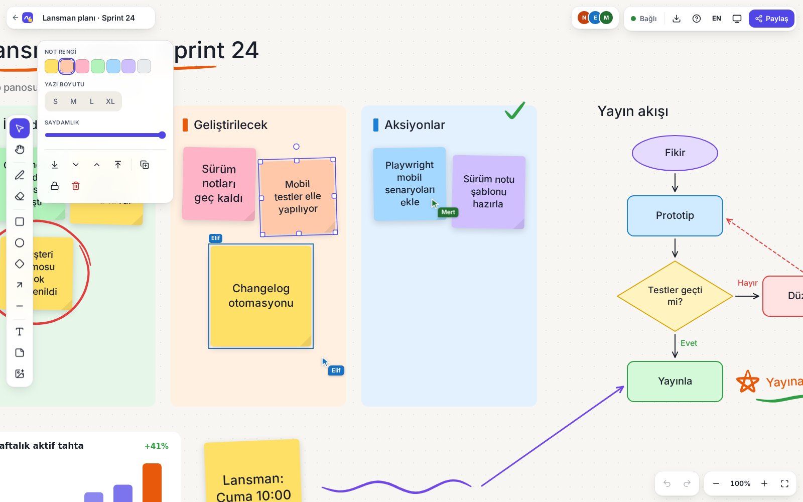
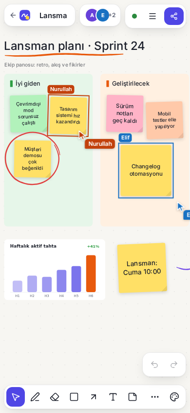
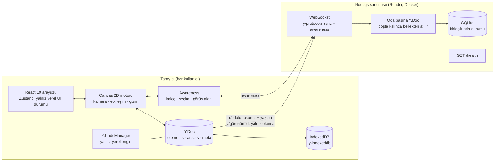

# Pano — gerçek zamanlı ortak çalışma tahtası

[](https://github.com/nurullahmencik/pano-whiteboard/actions/workflows/ci.yml)


**Canlı demo:** https://nurullahmencik.github.io/pano-whiteboard/

Pano, birden çok kişinin aynı anda çizip yazdığı bir online beyaz tahtadır. Linki paylaşırsın, herkes aynı tahtayı canlı görür: imleçler, seçimler, yapışkan notlar, şekiller, oklar ve serbest çizimler milisaniyeler içinde karşıya geçer. Bağlantı koparsa çalışmaya devam edersin; ağ geri geldiğinde değişiklikler **CRDT (Yjs)** sayesinde çakışmasız birleşir.



İki ayrı pencere, aynı tahta (Playwright ile gerçek iki istemciden kaydedildi):



> Video sürümü: [`docs/demo.webm`](docs/demo.webm)

## Özellikler

**Tuval ve araçlar**
- Sonsuz tuval: tekerlekle kaydırma, `Ctrl` + tekerlek / trackpad ile imleç merkezli yakınlaştırma, dokunmatikte iki parmakla kaydırma ve yakınlaştırma.
- Serbest çizim: giriş dengeleme (streamline), Laplace yumuşatma, Ramer–Douglas–Peucker sadeleştirme ve hıza göre değişen, basınç benzeri kalınlık (kalemde gerçek basınç).
- Dikdörtgen, elips, karar (eşkenar dörtgen), ok ve çizgi; şekillerin içine etiket yazılabilir.
- Metin ve yapışkan not (metin kutuya sığana kadar otomatik küçülür).
- Görsel ekleme: sürükle-bırak, yapıştır ya da araçla seç. Görseller tarayıcıda küçültülüp WebP olarak yeniden kodlanır (görsel başına ≤ 300 KB, tahta başına ≤ 3 MB, kaynak dosya ≤ 8 MB).
- Seçme, kutuyla çoklu seçim, taşıma, 8 tutamaçla boyutlandırma (Shift: oranı koru), döndürme (Shift: 15° adım), okların uç noktalarını sürükleme.
- Silgi, çizgi/dolgu/not rengi, kalınlık, kesikli çizgi, yazı boyutu, saydamlık, katman sırası (en öne / bir öne / bir geri / en arkaya), çoğaltma, kilitleme, kopyala-yapıştır.

**Canlı işbirliği**
- Diğer kullanıcıların imleçleri isim ve renkleriyle; ~25 Hz gelen konumlar her karede yumuşak interpolasyonla kayar.
- Kimin neyi seçtiği tuvalde kendi renginde ve isim etiketiyle görünür.
- Çevrimiçi kişiler listesi, görünen adı değiştirme.
- **Takip et** modu: birinin görüş alanını (konum + yakınlaştırma) izle; kaydırınca ya da `Esc` ile bırakılır.
- Aynı yapışkan nota iki kişi aynı anda yazabilir: metinler `Y.Text`, karakter düzeyinde birleşir ve imleç konumu korunur.

**Çevrimdışı ve bağlantı**
- Her değişiklik önce cihazdaki IndexedDB'ye yazılır (y-indexeddb); sayfa yenilense de kaybolmaz.
- Ağ kesilince çizmeye devam edilir, geri gelince otomatik birleşir. Bağlantı durumu göstergesi: *Bağlı / Bağlanıyor / Yeniden bağlanıyor / Çevrimdışı / Sunucu uyanıyor / Yerel mod*.
- Render free planda uyuyan sunucu için **"Sunucu uyanıyor…"** kartı: geçen süreyi gösterir, `/health` ucunu yoklayarak sunucuyu uyandırır ve hazır olunca beklemeden yeniden bağlanır. Bu sırada tahta tamamen kullanılabilir; bağlanınca her şey senkronlanır.

**Odalar ve paylaşım**
- Ana sayfada "Yeni tahta oluştur", dört şablon (boş, retro, akış diyagramı, beyin fırtınası), dolu bir **demo tahta** ve küçük resimli son açılan tahtalar.
- Paylaşım penceresi: düzenleme linki, isteğe bağlı **salt okunur link** ve QR kod. Salt okunur bağlantıdan gelen yazma mesajları **sunucuda reddedilir**.
- Dışa aktarma: PNG (1×/2×/3×) ya da SVG; tüm tahta veya yalnız seçili nesneler; arka planlı ya da şeffaf.
- Kişiye özel **geri al / yinele** (`Y.UndoManager`): yalnızca senin değişikliklerini geri alır, başkasınınkine dokunmaz.

**Arayüz**
- TR varsayılan, EN geçişli; tüm metinler i18n sözlüğünden gelir. Açık / koyu / sistem teması.
- Mobilde alt araç çubuğu, "diğer araçlar" menüsü ve açılır stil paneli.
- Erişilebilirlik: tüm kontroller klavyeyle kullanılabilir, `?` ile kısayol yardımı, ekran okuyucu etiketleri, WCAG AA kontrastlı varlık renkleri.

| | |
|---|---|
|  |  |
| Koyu tema: Elif, Nurullah'ı takip ediyor (çerçeve ve rozet Nurullah'ın renginde). | Seçim tutamaçları ve stil paneli; Elif yeni not yazıyor, Mert'in imleci görünüyor. |

<p align="center"></p>

## Mimari



```
pano-whiteboard/
├─ web/                    React 19 + Vite 8 + TypeScript strict + Tailwind v4
│  ├─ src/lib/             saf modüller: geometri, çizgi yumuşatma, CRDT modeli, metin düzeni,
│  │                       canvas/SVG çizimi, şablonlar, demo tahta
│  ├─ src/canvas/          motor (BoardEngine), uzak imleçler, yerinde metin düzenleyici, görseller
│  ├─ src/collab/          BoardSession: Y.Doc + IndexedDB + WebSocket + awareness + undo
│  ├─ src/board, pages/    arayüz bileşenleri
│  ├─ test/                Vitest birim testleri
│  └─ e2e/                 Playwright testleri ve ekran görüntüsü/video üreticisi
├─ server/                 Node 22 + TypeScript + ws + y-protocols + node:sqlite
│  ├─ src/                 oda adresleme, protokol, limitler, kalıcılık, log
│  └─ test/                birim + gerçek WebSocket entegrasyon testleri
├─ docs/                   ekran görüntüleri, demo.gif / demo.webm
└─ render.yaml, .github/workflows/{ci,deploy}.yml
```

## Teknik kararlar

### Neden CRDT (Yjs)?
Beyaz tahtada aynı anda onlarca küçük değişiklik olur ve kullanıcılar çevrimdışı da çalışabilmelidir. OT (operational transformation) merkezi bir sunucunun işlemleri sıraya koymasını gerektirir; CRDT'de her istemci değişikliği yerelde hemen uygular ve güncellemeler hangi sırayla gelirse gelsin tüm kopyalar aynı sonuca yakınsar. Bu sayede:
- sunucu "aptal" bir aktarıcı + kalıcılık katmanı olarak kalır, iş mantığı istemcide yaşar;
- çevrimdışı düzenlemeler sonradan sorunsuz birleşir (e2e testleriyle doğrulanır);
- aynı nesnenin farklı alanlarını (biri taşırken diğeri rengini değiştirir) düzenlemek iki değişikliği de korur.

Veri modeli: `elements` (her nesne bir `Y.Map`), `assets` (görseller) ve `meta` (başlık). Serbest çizim noktaları `Y.Array` olduğundan çizim sürerken yalnızca yeni noktalar gönderilir (birkaç düzine bayt) ve diğerleri çizgiyi canlı görür. Metinler `Y.Text`'tir; textarea'daki değişiklik en küçük silme/ekleme farkına çevrilir. Katman sırası sayısal `z` ile tutulur, eşitlikte nesne kimliği kullanılır; böylece her istemci aynı sırayı çizer. Nokta tabanlı nesneler noktalarını kendi "nokta kutusu" (`pw × ph`) içinde saklar; boyutlandırma yalnız çerçeveyi değiştirir, noktaları yeniden yazmaz.

### Neden Canvas 2D (SVG değil)?
Binlerce nesnede SVG her şekil için bir DOM düğümü tutar; yerleşim, stil ve isabet testi tarayıcının işine dönüşür ve kaydırma/yakınlaştırma sırasında maliyet nesne sayısıyla büyür. Canvas 2D'de tek bir çizim döngüsü vardır:
- yalnızca bir şey değiştiğinde `requestAnimationFrame` ile çizilir; kamera dışındaki nesneler sınır kutusuyla elenir;
- serbest çizimlerin dış hattı `Path2D` olarak sürüm numarasıyla önbelleğe alınır;
- **ayrıntı düzeyi (LOD):** ekranda birkaç pikselden küçük kalan nesneler tek bir dikdörtgenle, okunamayacak kadar küçük metinler çubuklarla çizilir; küçük notlarda bulanık gölge atlanır;
- isabet testi geometrik yapılır (döndürülmüş çerçeveye dönüşüm, segment mesafesi, elips denklemi).

Uzak imleçler ise DOM'da tutulur (her zoom'da keskin, `transform` ile ucuz taşınır), metin düzenleme yerinde açılan bir `textarea` ile yapılır. SVG yalnız dışa aktarma ve ana sayfadaki önizleme için kullanılır; ikisi de aynı saf çizim modüllerinden beslenir.

**Ölçülen performans** (`npm run bench -w web`, headless Chromium, yazılımsal raster, 1440×900; 3 sn boyunca her karede kaydırma):

| Nesne sayısı | Görünüm | Ortalama kare | p95 kare |
|---|---|---|---|
| 1.000 | tamamı ekranda (zoom 0,29) | 16,7 ms (60 fps) | 16,8 ms |
| 3.000 | tamamı ekranda (zoom 0,12) | 16,7 ms (60 fps) | 16,8 ms |
| 5.000 | tamamı ekranda (zoom 0,10) | 16,7 ms (60 fps) | 16,7 ms |
| 5.000 | zoom 0,35 ve 1,0 | 16,7 ms (60 fps) | 16,8 ms |

LOD eklenmeden önce 3.000 nesne tamamı ekrandayken ~23 fps ölçülmüştü. (Headless tarayıcıda `requestAnimationFrame` 60 Hz ile sınırlı olduğundan 60 fps üst sınırdır.)

### Awareness (varlık bilgisi)
İmleç, seçim, görüş alanı ve "düzenliyor" bilgisi belgeye değil **Yjs awareness** kanalına yazılır: kalıcı değildir, geçmişi şişirmez ve geri alma yığınına girmez. İmleç en fazla 40 ms'de bir gönderilir (son konum her zaman gider), görüş alanı 120 ms'de bir. Takip modu, izlenen kişinin görünür dünya dikdörtgenini kendi ekranına sığdıracak kamerayı hesaplar ve oraya yumuşakça geçer. Kamera, tahta yüklenirken içeriğe bir kez sığdırılır; ilk senkrondan sonra uzak değişiklikler pasif bir izleyicinin kamerasını asla oynatmaz.

### Geri alma kapsamı
Her kullanıcının kendi `Y.UndoManager`'ı vardır ve yalnızca `LOCAL_ORIGIN` ile yapılan işlemleri izler. Ağdan gelen güncellemeler, IndexedDB'den yüklenenler ve şablon tohumlama farklı origin'lerle uygulandığı için yığına hiç girmez. Bir sürükleme, boyutlandırma ya da çizim (onlarca ara güncelleme) `beginBatch/endBatch` ile **tek adım** olarak geri alınır. Geri alma da bir CRDT işlemidir: başkasının sonradan yaptığı değişiklikleri ezmez (birim ve e2e testleriyle doğrulanır).

### Çevrimdışı ve "sunucu uyanıyor"
- `y-indexeddb` her güncellemeyi yerelde saklar; tahta sunucusuz açılır.
- Tarayıcı `offline` olunca WebSocket bilerek kapatılır, `online` olunca yeniden açılır; y-websocket'in senkron adımları eksik güncellemeleri iki yönde de gönderir.
- İlk senkron 3,5 sn içinde olmazsa durum **waking** olur, `/health` 4 sn'de bir yoklanır (Render'ı uyandıran HTTP isteği) ve cevap gelince bekleme süresi atlanarak hemen yeniden bağlanılır.
- Free plandaki disk geçicidir: sunucu yeniden başlarsa SQLite'taki odalar silinebilir. İstemciler tam kopyayı IndexedDB'de tuttuğu için odaya ilk bağlanan düzenleyici durumu sunucuya geri yükler.

### Odalar, salt okunur linkler ve güvenlik (sunucuda gizli değer yok)
- Oda kimliği istemcide üretilen 128 bit rastgele değerdir (`r/<odaId>`) ve düzenleme yetkisinin kendisidir.
- Salt okunur kimlik `v/<görünümId>`, `base64url(sha256("pano:view:" + odaId))` ile türetilir. Sunucu her iki adresi aynı iç anahtara (görünüm kimliği) çevirir; tek yönlü özet olduğu için salt okunur linkten düzenleme linki elde edilemez. Sunucu hiçbir sır tutmaz, yeniden başlamadan etkilenmez ve ham oda kimliklerini diske hiç yazmaz.
- Salt okunur bağlantıdan gelen `sync step 2` / `update` mesajları uygulanmadan atılır ve loglanır; okuma ve awareness serbesttir.
- Bağlantı öncesi: oda kimliği biçim doğrulaması (400), isteğe bağlı `Origin` izin listesi (403), IP başına eşzamanlı bağlantı ve dakikalık bağlantı hızı sınırı (429).
- Bağlantı sırasında: mesaj boyut sınırı (`maxPayload`, aşılırsa 1009), bağlantı başına mesaj/s ve bayt/s token bucket (aşılırsa 1008), oda boyutu üst sınırı, bozuk güncellemelerde 1007, yalnız ikili çerçeve. Awareness'ta başka bir adresten gelen sahte istemci kimlikleri reddedilir; aynı adresten yeniden bağlanan istemci kendi kimliğini devralır.
- Boşta kalan odalar (varsayılan 60 sn) kalıcı hale getirilip bellekten atılır; değişiklikler 2 sn debounce ile (en geç 10 sn) SQLite'a yazılır; `SIGTERM`'de tüm odalar kaydedilir.
- Her olay tek satırlık JSON log'dur (`connection.open`, `write.rejected_read_only`, `room.unloaded`…). Loglarda oda anahtarının yalnız ilk 8 karakteri yer alır.
- Görsel varlıkları eşlerden geldiği için yalnızca `data:image/...` URL'leri çizilir ve dışa aktarılır.

## Çalıştırma

Gereksinim: Node 22.12+.

```bash
npm ci
npm run dev          # sunucu :5312 (tsx watch) + web :5311 (Vite)
# http://localhost:5311/pano-whiteboard/
```

Web, sunucuya `VITE_WS_URL` ile bağlanır (geliştirmede varsayılan `ws://localhost:5312`). Üretim derlemesinde değer boşsa uygulama **yerel modda** çalışır (yalnız IndexedDB).

Sunucu ortam değişkenleri (hepsi isteğe bağlı, gizli değer yok):

| Değişken | Varsayılan | Açıklama |
|---|---|---|
| `PORT` / `HOST` | `5312` / `0.0.0.0` | Render `PORT`'u kendisi verir |
| `DB_PATH` | `./data/pano.db` | SQLite dosyası (`:memory:` da olur) |
| `ALLOWED_ORIGINS` | boş (hepsi) | Virgülle ayrılmış `Origin` listesi |
| `TRUST_PROXY` | `false` | `X-Forwarded-For`'daki ilk IP'yi kullan |
| `MAX_MESSAGE_BYTES` | 4 MiB | Tek WebSocket çerçevesi üst sınırı |
| `MAX_DOC_BYTES` | 16 MiB | Oda başına yaklaşık üst sınır |
| `MAX_CONNECTIONS_PER_IP` | 20 | Eşzamanlı bağlantı |
| `CONNECTIONS_PER_MINUTE` | 60 | IP başına yeni bağlantı hızı |
| `MESSAGES_PER_SECOND` / `BYTES_PER_SECOND` | 200 / 2 MiB | Bağlantı başına hız sınırı |
| `ROOM_IDLE_MS` / `PERSIST_DEBOUNCE_MS` | 60000 / 2000 | Bellekten atma ve kayıt gecikmesi |
| `LOG_LEVEL` | `info` | `debug`, `info`, `warn`, `error`, `silent` |

## Test ve kalite kapısı

```bash
npm run lint         # ESLint (typescript-eslint strictTypeChecked + react-hooks), 0 uyarı
npm run typecheck    # tsc, web ve server
npm test             # Vitest: web birim + server birim/entegrasyon (gerçek WebSocket, port 5312)
npm run build -w server && npm run build:e2e -w web
npm run test:e2e     # Playwright: üretim derlemesi + yerel sunucu
npm run screenshots -w web   # docs/screenshots ve docs/demo.webm'i yeniden üretir
npm run bench -w web 5000    # kare süresi ölçümü (önizleme ve sunucu açıkken)
```

| Kapı | Sonuç |
|---|---|
| ESLint (web + server) | 0 hata, 0 uyarı |
| TypeScript strict (web + server) | temiz |
| Vitest – web | 62 test: geometri (isabet testi, seçim kutusu, dönüşümler, kamera), çizgi yumuşatma ve dış hat, CRDT modeli (ekleme/değiştirme/silme, katman sırası), iki `Y.Doc`'un çakışan eşzamanlı düzenlemeleri, `UndoManager`'ın yalnız yerel değişikliği geri alması, i18n, şablonlar, SVG dışa aktarma |
| Vitest – server | 21 test (8 birim + 13 gerçek WebSocket entegrasyon): iki istemci senkronu, oda izolasyonu, salt okunur yazmanın reddi, salt okunur linkin düzenleme linkine çevrilememesi, aşırı büyük mesajın 1009 ile reddi, geçersiz oda/origin, IP bağlantı sınırı, mesaj hızı sınırı, yeniden bağlanınca durumun korunması, bellekten atma + yeniden başlatma sonrası SQLite'tan geri yükleme, awareness sahteciliği ve devralma |
| Playwright e2e | 10 test: iki ayrı browser context'te şekil + imleç + varlık senkronu, araçlar (boyutlandırma, döndürme, metin, silgi, görsel yükleme), takip modu, çevrimdışı çizilen şeklin bağlantı gelince karşıya geçmesi, "sunucu uyanıyor" akışı (yerel çizim, yenileme, uyanınca senkron), kişiye özel geri al/yinele, PNG/SVG dışa aktarma (tüm tahta + seçim), salt okunur link, şablon/son tahtalar/dil, mobil görünüm (390×844, dokunmatik) |
| Lighthouse mobil (ana sayfa) | Performance 100, Accessibility 100, Best Practices 100, SEO 100 |

CI (`.github/workflows/ci.yml`) aynı adımları her push/PR'da çalıştırır.

## Dağıtım

### Sunucu → Render (Docker)
- `server/Dockerfile` depo kökünü bağlam olarak kullanır (npm workspaces tek lockfile paylaşır): `docker build -f server/Dockerfile -t pano-server .`
- Konteyner `$PORT`'u dinler (Render free planında 10000), `GET /health` sağlık ucudur; Dockerfile'da da `HEALTHCHECK` vardır.
- `render.yaml` örnek bir Blueprint'tir (plan `free`, `healthCheckPath: /health`, `TRUST_PROXY=true`, `ALLOWED_ORIGINS=https://nurullahmencik.github.io`). Gizli değer gerekmez.
- Free plan notları: 15 dk trafik yoksa servis uyur ve ilk istekte 30–60 sn'de açılır (istemci bunu "Sunucu uyanıyor…" kartıyla karşılar); disk geçicidir (bkz. çevrimdışı bölümü).

### Web → GitHub Pages
- `.github/workflows/deploy.yml`, `main`'e her push'ta `web/dist`'i Pages'e yollar.
- Vite `base: '/pano-whiteboard/'`; derleme `404.html` kopyası üretir, böylece `/pano-whiteboard/b/<id>` gibi derin linkler doğrudan açılır.
- Sunucu adresi **`WS_URL` repo değişkeninden** gelir (Settings → Variables → Actions; örn. `wss://pano-server.onrender.com`), derlemede `VITE_WS_URL` olarak gömülür.

## Klavye kısayolları (özet)

`V` seç · `H` kaydır · `P` kalem · `E` silgi · `R` dikdörtgen · `O` elips · `D` karar · `A` ok · `L` çizgi · `T` metin · `S` not · `I` görsel · `Ctrl+Z` / `Ctrl+Shift+Z` geri al / yinele · `Del` sil · `Ctrl+D` çoğalt · `Ctrl+A` tümünü seç · `[` `]` katman · `Shift+1` tümünü sığdır · `0` %100 · `Boşluk` + sürükle kaydır · `Esc` seçimi/takibi bırak · `?` yardım

## Bilinen sınırlar
- Oklar şekillere "bağlı" değildir; şekil taşınınca ok takip etmez.
- Kimlik doğrulama yoktur: oda linkine sahip olan herkes düzenleyebilir (salt okunur link hariç). Kullanıcı adları kişinin kendi beyanıdır.
- Render free planında sunucu yeniden başlarsa, o odaya bir düzenleyici yeniden bağlanana kadar yalnız salt okunur izleyiciler boş tahta görebilir.

## Lisans
MIT — bkz. [LICENSE](LICENSE).

---

## English summary

**Pano** is a real-time collaborative whiteboard: share a link and everyone draws, writes and moves sticky notes on the same infinite canvas, live. It is built with **React 19, Vite, TypeScript (strict), Tailwind v4 and Zustand** on the client and a **Node + TypeScript WebSocket server** speaking the Yjs protocol.

- **Conflict-free sync with Yjs CRDTs**: elements are `Y.Map`s, strokes stream as `Y.Array` appends, text is `Y.Text` (two people can type in one note). Offline-first via IndexedDB; edits made offline merge automatically on reconnect.
- **Presence through Yjs awareness**: interpolated remote cursors, remote selections, online list and a follow mode.
- **Per-user undo/redo** with `Y.UndoManager` scoped to the local origin, so you never undo someone else's work; whole gestures undo as one step.
- **Canvas 2D renderer** with viewport culling, cached `Path2D` outlines and level-of-detail rendering: 5,000 elements pan at 60 fps in headless Chromium.
- **Secret-free read-only links**: `viewId = sha256("pano:view:" + roomId)`; the server maps both to the same room and drops writes from view connections.
- **Hardened server**: room id validation, origin allow-list, per-IP connection and rate limits, message/room size limits, idle room unloading, SQLite persistence, `/health`, structured JSON logs, Dockerfile for Render (listens on `$PORT`).
- **UX**: wake-up screen for a sleeping free-tier server (you can keep drawing meanwhile), PNG/SVG export, share dialog with QR code, templates and a rich demo board, TR/EN, light/dark, keyboard shortcuts (`?`), mobile toolbar.
- **Quality gate**: ESLint 0 warnings, strict typecheck, 62 web unit tests, 21 server tests (13 against a real WebSocket server), 10 Playwright end-to-end tests with two browser contexts, Lighthouse mobile 100/100/100/100 on the landing page.

Run locally with `npm ci && npm run dev`, then open http://localhost:5311/pano-whiteboard/. Licensed under MIT.
